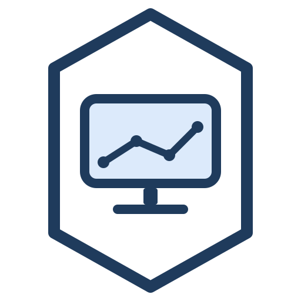

<p align="center"><a href="README.md">English</a> | <a href="README.ko.md">한국어</a></p>

<p align="center">
  
</p>

<h1 align="center">K-Watch</h1>

<p align="center">
  <strong>See how your namespace connects. Watch your Pods change.</strong><br />
  A read-only dashboard for exploring Kubernetes resource relationships
</p>

<p align="center">
  <a href="https://github.com/klolarion/k_watch/actions/workflows/ci.yml"></a>
  <a href="LICENSE"></a>
  <a href="charts/k-watch"></a>
</p>

---

Which workload does this Service route to? Which node is this Pod running on? How are Pods changing after a deployment?

K-Watch maps resource relationships **one namespace at a time**. Follow connections from Ingress to Services, workloads, and storage, while watching Pod creation, status changes, and deletion on the same map. Install one Pod per cluster and open it in your browser.

[Features](#features) · [Quick start](#quick-start) · [Usage](#usage) · [Configuration](#configuration) · [Permissions and access control](#permissions-and-access-control) · [Troubleshooting](#troubleshooting) · [Development](#development)

## Features

### Resource maps for each namespace

Explore relationships between Deployments, StatefulSets, DaemonSets, Jobs, CronJobs, Services, Ingresses, PVCs, and PVs. The map summarizes Pod counts and status per workload, keeping resource relationships readable even in busy namespaces.

- **Explore connections** — Click a resource to highlight related paths and open its details panel.
- **Inspect Pods** — View the status, node, and restart count of the Pods behind your selection, along with the nodes they run on.
- **Follow storage relationships** — See which PV each PVC is bound to. Select a PVC to view its PV status and size and highlight the workloads that use it.
- **Reduce completed Job clutter** — Completed Jobs owned by CronJobs are hidden. Only the 20 newest completed standalone Jobs appear on the map. Active Jobs remain visible.

### Live Pod changes

Kubernetes Watch and Server-Sent Events (SSE) stream Pod events from the selected namespace. Pods briefly appear on the map when they are created, deleted, or change status, along with container waiting reasons such as `CrashLoopBackOff`.

> The live stream shows Pod changes. Use the refresh button in the header to reload resource configuration and summary counts, including workloads and Services. Connections reflect Kubernetes resource configuration; they are not measurements of actual network traffic.

### Cluster overview and namespace list

- **Overview** — Inspect cluster resource counts, node health, Pod status distribution, workloads by namespace, and recent events.
- **Node utilization** — View CPU and memory usage supplied by metrics-server. Metrics collection is optional.
- **Namespace list** — Search by name and compare Pod counts, unhealthy Pods, and resource counts to choose a namespace to explore.
- **Cluster bookmarks** — Save the addresses of K-Watch installations in other clusters and navigate between them.

## Quick start

### Prerequisites

- A Kubernetes cluster and `kubectl` configured to access it
- Helm 3.8 or later with OCI chart support
- Permission to create the chart resources, including a ServiceAccount, ClusterRole, and ClusterRoleBinding
- metrics-server if you want node CPU and memory usage

The chart declares a Kubernetes version constraint of `>=1.21.0-0`. Container images are built for `linux/amd64` and `linux/arm64`.

### 1. Install with Helm

```bash
helm install k-watch oci://ghcr.io/klolarion/charts/k-watch \
  --version 0.1.3 \
  --namespace k-watch \
  --create-namespace
```

You can also install the chart directly from a checkout of this repository:

```bash
helm install k-watch ./charts/k-watch --namespace k-watch --create-namespace
```

### 2. Forward a local port

```bash
kubectl -n k-watch rollout status deployment/k-watch
kubectl -n k-watch port-forward svc/k-watch 8282:8282
```

### 3. Open your browser

Visit [http://localhost:8282](http://localhost:8282). Keep the `port-forward` command running while you use the dashboard.

> These examples use Bash syntax. In PowerShell, remove the trailing `\` characters and run each multiline command on a single line.

## Usage

1. **Start with Overview.** Use node health, Pod distribution, and recent events to identify what to investigate.
2. **Choose a namespace in Map.** Check the `Unhealthy` column for namespaces with unhealthy Pods, or search by name.
3. **Click a resource on the map.** Inspect highlighted connections and the Pod, node, and volume details in the right panel. The Pod list shows up to 50 entries and indicates the total count.
4. **Watch the Live indicator and Pod events.** Follow creation, deletion, and status changes. Use the refresh button in the header after resource configuration changes to reload the map.

### Switching between clusters

Each K-Watch installation reads **one cluster**. To use it with multiple clusters, install it in each cluster, then choose **Cluster → Add** in the header to save a name and address. Selecting a bookmark navigates to that K-Watch installation.

When accessing multiple installations locally, use different local ports. Run each command below in a separate terminal:

```bash
kubectl --context cluster-a -n k-watch port-forward svc/k-watch 8282:8282
kubectl --context cluster-b -n k-watch port-forward svc/k-watch 8283:8282
```

Bookmarks are saved in browser localStorage, so they are specific to the browser and origin you use to access K-Watch.

## Configuration

See [values.yaml](charts/k-watch/values.yaml) for all options and defaults.

The default installation uses a `ClusterIP` Service on port `8282`, with Ingress disabled. Container resource requests are `100m` CPU and `128Mi` memory; limits are `500m` CPU and `512Mi` memory. You can also configure `nodeSelector`, `tolerations`, `affinity`, and `imagePullSecrets`.

### Access through Ingress

Check your cluster's IngressClass and authentication setup, then create a values file. K-Watch has no built-in login, so configure authentication through your Ingress controller or an authentication proxy.

```yaml
# my-values.yaml
ingress:
  enabled: true
  className: traefik # Replace with your cluster's IngressClass
  hosts:
    - host: k-watch.example.com
      paths:
        - path: /
          pathType: Prefix
  tls:
    - secretName: k-watch-tls # An existing TLS Secret
      hosts:
        - k-watch.example.com
```

```bash
helm upgrade --install k-watch oci://ghcr.io/klolarion/charts/k-watch \
  --version 0.1.3 \
  --namespace k-watch \
  --create-namespace \
  -f my-values.yaml
```

Live Pod updates require SSE connections through the Ingress. Check your proxy's response buffering and connection timeout settings as well.

### Uninstall

```bash
helm uninstall k-watch --namespace k-watch
```

This also removes the ClusterRole and ClusterRoleBinding created by the chart. The `k-watch` namespace remains.

## Permissions and access control

The default Helm deployment uses a **read-only ServiceAccount** with cluster-wide access.

- **Readable resources** — Pods, Services, Namespaces, Nodes, PVs, PVCs, Events, Deployments, ReplicaSets, StatefulSets, DaemonSets, Jobs, CronJobs, Ingresses, EndpointSlices, and node and Pod metrics
- **Allowed operations** — `get`, `list`, and `watch` for regular resources; `get` and `list` for metrics
- **Excluded permissions** — Secrets, ConfigMaps, resource creation, updates, deletion, Pod exec, and Pod log access
- **Default container settings** — UID/GID `65532`, a read-only root filesystem, privilege escalation disabled, all Linux capabilities dropped, and `RuntimeDefault` seccomp

See [rbac.yaml](charts/k-watch/templates/rbac.yaml) for exact permissions and [values.yaml](charts/k-watch/values.yaml) for container settings.

**Anyone who can reach K-Watch can view the cluster information available to its ServiceAccount.** Namespace selection controls what the UI displays; it does not provide per-user authorization. The default ClusterIP Service is also reachable from the cluster network. Use `kubectl port-forward` for local access, and protect shared endpoints with an authentication proxy, Ingress authentication, or a VPN.

## Troubleshooting

### The dashboard does not open

Check that the Pod is ready and port forwarding is running:

```bash
kubectl -n k-watch get pods
kubectl -n k-watch logs deployment/k-watch
```

If local port `8282` is already in use, forward `8283:8282` instead and visit `http://localhost:8283`.

### CPU and memory usage are missing

Check that metrics-server is installed and serving metrics:

```bash
kubectl top nodes
```

Resource maps and Pod events work without metrics.

### Resource requests fail, or Live shows Stopped

Check the on-screen error and backend logs. For `Forbidden` errors, check the ServiceAccount's read and Watch permissions. For example, check Pod Watch access for the default installation with the command below. Your user needs permission to impersonate this ServiceAccount to run this check.

```bash
kubectl auth can-i watch pods --all-namespaces \
  --as=system:serviceaccount:k-watch:k-watch
```

After fixing permissions or connectivity, use the refresh button in the header to reconnect. If events are delayed or connections drop only through Ingress, check the proxy's SSE settings too.

## Development

The Go backend (Gin and client-go) queries the Kubernetes API and serves the React and TypeScript frontend. The map uses Cytoscape.js; Overview charts use Recharts. A deployed installation does not need a separate frontend server.

```text
backend/         API, resource relationships, Pod Watch → SSE
frontend/        Overview, namespace map, details panel
charts/k-watch/  Helm chart and read-only RBAC
dev/             Local development guide and test manifests
scripts/         Release version consistency check
```

Local development requires Go 1.26 or later and Node.js 22. See the **[development guide (Korean)](dev/README.md)** for local setup, validation commands, Minikube deployment, and demo resources.

### Releases

1. Update `version`, `appVersion`, and the `artifacthub.io/images` annotation in [Chart.yaml](charts/k-watch/Chart.yaml), along with the `--version` examples in [README.md](README.md), [README.ko.md](README.ko.md), and the [chart README](charts/k-watch/README.md).
2. Run `scripts/check-version.sh <version>` to verify version consistency.
3. Push a tag such as `v0.1.0`. The [release workflow](.github/workflows/release.yml) verifies versions and publishes multi-architecture images and the OCI Helm chart to GHCR.
4. After the first release, set the `k-watch` and `charts/k-watch` packages to Public in GHCR.

## License

[Apache License 2.0](LICENSE)
